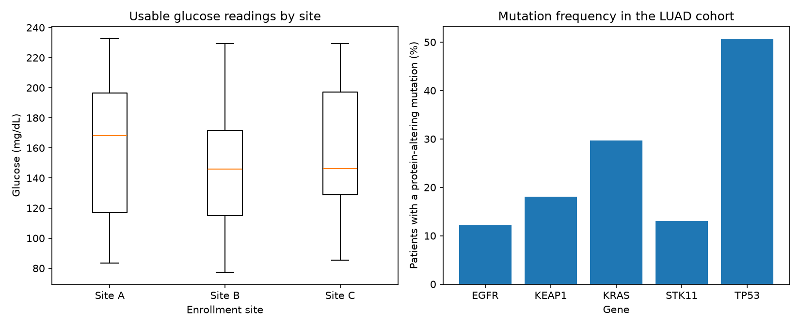

# Summary report

Numbers below are read from `combined_summary.tsv`, which the pipeline builds from the cleaned samples table and the patient feature table.

## Samples (messy_samples.csv)

- 60 records cleaned; 18 have no usable sex value.
- 47 glucose readings are usable. 13 were labeled mmol/L but hold values of 70-250, which cannot be real mmol/L glucose, so they were left blank instead of converted. 0 had no value ("N/A").
- Median usable glucose: 148.0 mg/dL.

## Patients (cohort.db)

- 566 patients, one row each. 52 are missing sex and 71 are missing age at diagnosis.
- Median age at diagnosis: 66 years. Median tumor mutation burden: 6.7.
- Share of patients with at least one protein-altering mutation: EGFR 12%, KEAP1 18%, KRAS 30%, STK11 13%, TP53 51%.

